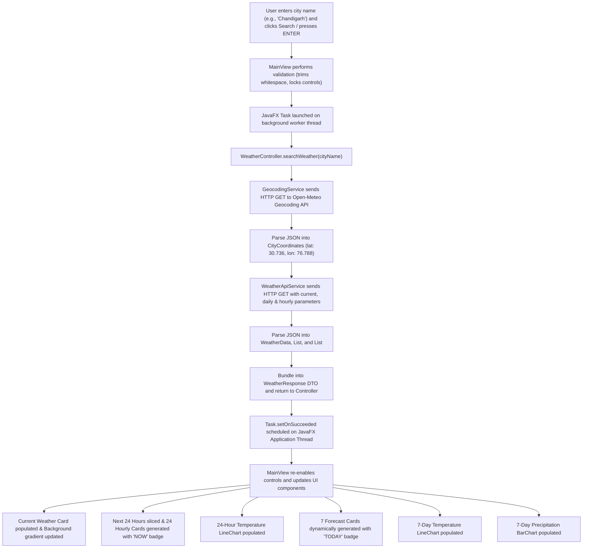

# Weather Forecasting & Visualization System

A modular, production-ready desktop weather application built with **Java 17+** and **JavaFX 21** that retrieves real-time meteorological observations, hourly progressions, and multi-day forecasts from the **Open-Meteo REST API**, presenting live data through an interactive dashboard with dynamic cards, visual analytics, and condition-reactive modern styling.

---

## 📌 1. Project Overview

The **Weather Forecasting & Visualization System** is a professional desktop application designed following the industry-standard **Model-View-Controller (MVC)** architectural pattern. 

In traditional desktop applications, executing long-running network operations directly within event handlers causes the graphical user interface to freeze and become unresponsive. This project addresses that challenge by decoupling network I/O into asynchronous background daemon workers managed via `javafx.concurrent.Task`, while ensuring that UI rendering and state mutations occur strictly on the JavaFX Application Thread.

The system allows users to search for any city globally, automatically resolves the query into high-precision geographic coordinates via geocoding, queries live atmospheric telemetry, and renders:
1. **Current Meteorological Conditions**: Ambient temperature, perceived ("feels-like") temperature, WMO condition text with icon emojis, relative humidity, wind velocity in km/h, barometric pressure, and local observation timestamps.
2. **24-Hour Hourly Forecast Outlook**: The current hour (marked with a prominent `NOW` badge) plus the subsequent 23 hours in a horizontal scrolling card row showing hourly time (e.g., `1 PM`), condition emojis, actual temperatures, apparent temperatures, and weather descriptions.
3. **24-Hour Temperature Trend Chart**: An interactive JavaFX `LineChart` plotting the progression of hourly temperatures across the next 24 hours.
4. **7-Day Dynamic Forecast Outlook**: Daily minimum/maximum temperatures, weather summaries, precipitation probabilities, and wind speeds rendered in individual responsive cards with hover micro-interactions and a `TODAY` badge.
5. **7-Day Temperature Trend Chart**: An interactive JavaFX `LineChart` plotting daily maximum and minimum temperature curves.
6. **7-Day Precipitation Probability Chart**: A JavaFX `BarChart` displaying rain and snow chances calibrated from 0% to 100%.
7. **Condition-Reactive Backgrounds**: Subtle, modern background gradients that dynamically react to current conditions (Clear, Clouds, Rain, Thunderstorm, Snow, Fog) while preserving crisp text readability.
8. **Defensive Stale-Data Clearing**: Automatically purges all previous weather data, forecast cards, and charts immediately upon launching a new search or encountering a lookup failure.

---

## 🛠️ 2. Technologies & Dependencies

| Technology | Version / Specification | Purpose |
| :--- | :--- | :--- |
| **Java Development Kit** | OpenJDK 17+ (LTS) | Core object-oriented programming language |
| **JavaFX** | 21.0.2 | Desktop GUI framework (`javafx-controls`, `javafx-graphics`, `javafx-fxml`) |
| **Apache Maven** | 3.9+ / Maven Wrapper (`mvnw`) | Build automation, dependency management, and lifecycle execution |
| **org.json** | 20240303 | Lightweight JSON parser for transforming API payloads into Java domain models |
| **Open-Meteo Geocoding API** | REST / JSON | Translates city names into decimal latitude and longitude coordinates |
| **Open-Meteo Forecast API** | REST / JSON | Provides current weather telemetry, 7-day daily forecasts, and hourly time-series |
| **javafx-maven-plugin** | 0.0.8 | Launches the application directly via `mvn javafx:run` |

---

## ✨ 3. Complete Feature Set

- [x] **Global Geocoding**: Queries Open-Meteo's geocoding database with URL-encoded city strings.
- [x] **Live Meteorological Telemetry**: Real-time ambient temperature, humidity, surface pressure, wind speed, and WMO codes.
- [x] **24-Hour Hourly Weather Pipeline**: Queries Open-Meteo's `hourly=temperature_2m,apparent_temperature,weather_code` and automatically slices the next 24 consecutive hours starting at the city's current local hour.
- [x] **Hourly Forecast Cards**: Displays time (`1 PM`), condition emojis, temperature, feels-like, and condition text with a distinct `NOW` badge for the current hour.
- [x] **24-Hour Temperature Line Chart**: Plots actual hourly temperatures across the 24-hour window using `LineChart<String, Number>`.
- [x] **Dynamic 7-Day Forecast Cards**: Iterates through `List<Forecast>` with a reusable builder; highlights the current day with a distinct `TODAY` badge.
- [x] **7-Day Temperature Trend Chart**: Visualizes daily high and low temperature curves with color-coded series.
- [x] **7-Day Precipitation Bar Chart**: Displays precipitation probability bars locked strictly to a 0%–100% scale.
- [x] **Atmospheric Background System**: Adapts background gradients dynamically based on real-time weather (Clear sky-blue, Cloud soft-gray, Rain cool-blue, Thunderstorm indigo, Snow crisp-white/blue, Fog misty-gray).
- [x] **Dual Scroll Architecture**:
  - Horizontal `ScrollPane` for side-to-side navigation of 24-hour cards and 7-day cards.
  - Primary vertical `ScrollPane` ensuring no content clipping on small laptop screens or low resolutions.
- [x] **Stale Data Protection**: Automatically purges previous city metrics, resets hourly/daily forecast cards, and clears all charts when an invalid query or network error occurs.
- [x] **Asynchronous Network Pipeline**: Employs `javafx.concurrent.Task` and daemon worker threads to keep the UI fluid while network requests are in-flight.
- [x] **Defensive Error Handling**: Gracefully handles whitespace input, unknown cities, network timeouts, thread interruptions, and malformed JSON without crashing.

---

## 🏗️ 4. MVC Architecture & Separation of Concerns

The codebase strictly adheres to the **Model-View-Controller** separation of concerns:

```
src/main/java/com/weather/
│
├── Main.java                          # Application Entry Point & Stage Configuration
├── SystemVerification.java            # Automated Verification Suite & Test Matrix Runner
│
├── model/                             # DATA LAYER (POJOs & DTOs)
│   ├── CityCoordinates.java          # Encapsulates latitude, longitude, city, country
│   ├── WeatherData.java              # Encapsulates instantaneous weather metrics
│   ├── HourlyForecast.java           # Encapsulates hourly forecast metrics (time, temp, feelsLike, code)
│   ├── Forecast.java                 # Encapsulates daily forecast metrics (LocalDate, temps, rain)
│   └── WeatherResponse.java          # DTO bundling WeatherData + List<Forecast> + List<HourlyForecast>
│
├── service/                           # BUSINESS & I/O LAYER (Zero JavaFX UI Code)
│   ├── GeocodingService.java         # HTTP Client communicating with Geocoding REST API
│   └── WeatherApiService.java        # HTTP Client communicating with Forecast REST API
│
├── controller/                        # CONTROLLER LAYER (Mediator / Orchestrator)
│   └── WeatherController.java        # Validates input, coordinates services, returns models
│
└── view/                              # PRESENTATION LAYER (JavaFX UI & Charts)
    └── MainView.java                 # Asynchronous UI, responsive cards, LineCharts, BarChart
```

### Layer Responsibilities
1. **Model (`com.weather.model`)**: Plain Old Java Objects (POJOs) representing domain entities with strict encapsulation (private fields, accessors, constructors). Completely decoupled from both networking and GUI classes.
2. **Service (`com.weather.service`)**: Encapsulates external REST API interactions via `java.net.http.HttpClient` and `org.json`. Contains zero JavaFX imports.
3. **Controller (`com.weather.controller`)**: Acts as a mediator between View and Service layers. Validates input strings, coordinates geocoding and forecast retrieval, and returns domain models. Contains zero UI layout code.
4. **View (`com.weather.view`)**: Constructs the JavaFX scene graph, binds event handlers, launches asynchronous `Task` workers, and updates controls on the JavaFX Application Thread. Contains zero HTTP networking logic.

---

## 🔄 5. End-to-End API Flow



---

## ⚡ 6. Asynchronous Architecture (`Task<WeatherResponse>`)

### The Single-Threaded UI Challenge
In JavaFX, the **JavaFX Application Thread** is exclusively responsible for processing input events, running animations, and repainting the scene graph at 60 FPS. If network requests (which can block for hundreds of milliseconds or seconds due to latency) are executed directly on this thread, the entire event queue stalls, freezing the window and causing operating systems to show a *"Not Responding"* state.

### The Asynchronous Solution
1. **Background Worker**: A `javafx.concurrent.Task<WeatherResponse>` executes the HTTP calls inside its `call()` method on a background daemon thread.
2. **Non-Blocking Control Locking**: The Search button and input field are disabled while `isSearching` is set to `true`, preventing duplicate requests.
3. **Thread-Safe Callbacks**:
   - `setOnSucceeded()`: Executes on the JavaFX Application Thread once network bytes are received and parsed. UI controls, cards, and charts update safely.
   - `setOnFailed()`: Fires if a network timeout or connection drop occurs, safely updating error labels, purging stale cards/charts, and re-enabling buttons.
   - `setOnCancelled()`: Restores controls if an operation is aborted.

---

## 🛡️ 7. Defensive Error Handling & Input Validation

The system implements multiple defensive guardrails:

- **Empty / Whitespace Input**: Input is trimmed immediately. If empty, search execution halts before any thread or network call is created, displaying: `❌ Please enter a city name.`
- **Invalid City Names**: If the geocoding service returns 0 results for a query (e.g. `InvalidCityXYZ98765`), the controller returns `null`, and the UI displays: `❌ Could not retrieve weather for "CITY". Please verify the city name or check your internet connection.`
- **Stale Data Protection**: Old metrics, hourly cards, daily cards, and charts are cleared immediately when a search begins. If the lookup fails, old weather data from a previous city is never left on screen.
- **Defensive JSON Parsing**: Uses `optDouble`, `optInt`, and `optJSONArray` with fallback defaults, ensuring that missing JSON fields never cause `NullPointerException` or application termination.
- **Chart Animation Stability**: Disables internal JavaFX chart animations (`setAnimated(false)`) to prevent runtime race conditions during rapid dataset clearance and repopulation.

---

## 💻 8. How to Build and Run

### Prerequisites
- Java Development Kit (**JDK 17** or higher)
- Internet connection (for live Open-Meteo REST API queries)

### 1. Compile the Project
```powershell
.\mvnw.cmd clean compile
```
*(On Linux/macOS: `./mvnw clean compile`)*

### 2. Run the JavaFX Application
```powershell
.\mvnw.cmd javafx:run
```
*(On Linux/macOS: `./mvnw javafx:run`)*

### 3. Run the Automated Verification Suite
```powershell
.\mvnw.cmd compile exec:java "-Dexec.mainClass=com.weather.SystemVerification"
```

---

## 🧪 9. Comprehensive Test Matrix

| Test Scenario | Input Query | Expected System Behavior | Result |
| :--- | :--- | :--- | :---: |
| **Live Search 1** | `Chandigarh` | Coordinates resolved (`30.736° N, 76.788° E`). Current weather, 24 hourly cards, 24-hr chart, 7-day cards, and daily charts populated. | **PASS** |
| **Live Search 2** | `London` | Replaces previous data. London hourly temperatures, daily curves, and rain chances rendered. Background updates. | **PASS** |
| **Live Search 3** | `Tokyo` | Replaces previous data. Tokyo forecast and charts rendered. Background updates. | **PASS** |
| **Invalid City** | `InvalidCityXYZ98765` | Stale data cleared. All cards and charts purged. Error message displayed: `❌ Could not retrieve weather...`. Zero crashes. | **PASS** |
| **Empty Input** | `""` | Immediate validation: `❌ Please enter a city name.`. No network request fired. | **PASS** |
| **Whitespace Input** | `"   "` | Immediate validation: `❌ Please enter a city name.`. No network request fired. | **PASS** |
| **Duplicate Prevention** | Rapid button clicks | Search button and text field disable instantly while task is running. | **PASS** |
| **Window Resizing** | `760x600` to `1920x1080` | Vertical scrollpane accommodates height; horizontal scrollpanes accommodate cards; zero clipping. | **PASS** |
| **Offline / Timeout** | Disconnected network | `IOException` caught gracefully; friendly error displayed; app remains interactive. | **PASS** |

---

## 🖥️ 10. User Interface Layout & Visual Hierarchy

The application layout follows a top-to-bottom structured hierarchy:

```
┌──────────────────────────────────────────────────────────────┐
│       WEATHER FORECASTING & VISUALIZATION SYSTEM             │
│   MVC Architecture • Live Weather API • Hourly & 7-Day Analytics │
├──────────────────────────────────────────────────────────────┤
│  [ Enter city name...              ]  [ Search Weather ]     │
│  ✓ Live weather data successfully retrieved from Open-Meteo!  │
├──────────────────────────────────────────────────────────────┤
│  CURRENT WEATHER IN TOKYO                                    │
│  Observed: 2026-10-22 at 17:00                               │
│                                                              │
│   20.8 °C      ☁️     Clouds                                 │
│   Feels 20.8 °C       Overcast clouds                        │
│                                                              │
│  [ 💧 Humidity: 68% ] [ 💨 Wind: 14.8 km/h ] [ ⏲ Pressure: 1012 hPa ] │
├──────────────────────────────────────────────────────────────┤
│  24-HOUR FORECAST                                            │
│  ┌──────────┐ ┌──────────┐ ┌──────────┐ ┌──────────┐ ...     │
│  │   NOW    │ │          │ │          │ │          │         │
│  │   5 PM   │ │   6 PM   │ │   7 PM   │ │   8 PM   │         │
│  │    ☁️    │ │    ☁️    │ │    🌧️   │ │    🌧️   │         │
│  │  20.8°C  │ │  20.4°C  │ │  19.8°C  │ │  19.2°C  │         │
│  │Feels 20.8│ │Feels 20.4│ │Feels 19.8│ │Feels 19.2│         │
│  │ Overcast │ │ Overcast │ │Light rain│ │Light rain│         │
│  └──────────┘ └──────────┘ └──────────┘ └──────────┘         │
│  ◀════════════════════════════════════════════════════════▶  │
├──────────────────────────────────────────────────────────────┤
│  24-HOUR TEMPERATURE TREND (LineChart)                       │
│  Temperature (°C) vs Hour                                    │
├──────────────────────────────────────────────────────────────┤
│  7-DAY WEATHER FORECAST                                      │
│  ┌────────────┐ ┌────────────┐ ┌────────────┐ ...            │
│  │   TODAY    │ │Fri, Oct 23 │ │Sat, Oct 24 │                │
│  │     ☁️     │ │     🌧️     │ │     ☀️     │                │
│  │ High 22.0°C│ │ High 19.5°C│ │ High 23.0°C│                │
│  │ Low  16.0°C│ │ Low  15.0°C│ │ Low  14.0°C│                │
│  │  ☔ 15% rain│ │  ☔ 85% rain│ │  ☔  5% rain│                │
│  └────────────┘ └────────────┘ └────────────┘                │
│  ◀════════════════════════════════════════════════════════▶  │
├──────────────────────────────────────────────────────────────┤
│  7-DAY TEMPERATURE TREND (LineChart: Max & Min curves)       │
├──────────────────────────────────────────────────────────────┤
│  7-DAY PRECIPITATION PROBABILITY (BarChart: 0% to 100%)      │
└──────────────────────────────────────────────────────────────┘
```

---

## 🎓 11. Academic Viva Voce Preparation (Questions & Answers)

### Q1: Why did you choose the Model-View-Controller (MVC) architectural pattern?
> **Answer**: MVC enforces strict separation of concerns:
> - **Model**: Encapsulates raw weather metrics without knowledge of how they are drawn or fetched.
> - **Service / Controller**: Handles business logic, input sanitization, and REST communication without JavaFX dependencies.
> - **View**: Solely responsible for presentation, layout, and event listeners.
> This makes the application testable, maintainable, and allows swapping out the UI (e.g. JavaFX to Web) or API provider without touching other components.

### Q2: Why must network requests NOT execute on the JavaFX Application Thread?
> **Answer**: JavaFX uses a single-threaded event loop to handle user inputs, scene graph modifications, and display rendering at 60 FPS. Network calls are blocking I/O operations with unpredictable latency. Running network I/O on the UI thread causes the UI to freeze, dropping frames and causing OS "Not Responding" errors.

### Q3: How does `javafx.concurrent.Task` ensure thread safety between background threads and the UI?
> **Answer**: `Task<T>` executes its `call()` method on a background thread. Its lifecycle hooks—`setOnSucceeded()`, `setOnFailed()`, and `setOnCancelled()`—are automatically scheduled by JavaFX to execute on the **JavaFX Application Thread**. This guarantees that all UI updates occur safely on the rendering thread without requiring manual `Platform.runLater()` boilerplate.

### Q4: Why are two separate REST API calls required to fetch weather for a city name?
> **Answer**: The Open-Meteo Forecast API requires exact geographic coordinates (`latitude` and `longitude`). Since users enter textual city names (e.g., "Chandigarh"), the system first queries the **Open-Meteo Geocoding API** to resolve the city name to latitude and longitude, and then passes those coordinates to the **Open-Meteo Forecast API**.

### Q5: How is stale data prevented when an invalid city is searched?
> **Answer**: Immediately when a search is initiated, `resetCurrentWeatherLabels()`, `resetHourlySection()`, `resetForecastSection()`, `clearCharts()`, and `clearHourlyTemperatureChart()` purge existing labels, card nodes, and chart series. If the new query fails, the interface displays an error message without showing any stale metrics from the previous city.

### Q6: Why did you disable JavaFX chart animations (`setAnimated(false)`)?
> **Answer**: JavaFX charts with animated transitions can throw internal concurrency exceptions or produce phantom category glitches when data series are rapidly cleared and repopulated on `CategoryAxis`. Setting `setAnimated(false)` ensures deterministic, immediate chart updates.

### Q7: How are timezone differences handled between cities globally?
> **Answer**: The query passes `&timezone=auto` to the Open-Meteo API. Open-Meteo returns observation and forecast timestamps aligned with the destination city's local timezone. The application reads these local ISO date-time strings without manually hardcoding UTC offsets.

### Q8: How does the application prevent duplicate requests when users repeatedly click "Search"?
> **Answer**: An atomic `isSearching` boolean flag locks the search procedure. As soon as a request starts, both the search button and input field are disabled (`setDisable(true)`). They are only re-enabled inside `setOnSucceeded()` or `setOnFailed()`.

---

## 🚀 12. Future Enhancements

1. **Air Quality Index (AQI) Telemetry**: Integration with Open-Meteo's Air Quality API to display PM2.5, PM10, UV Index, and ozone metrics.
2. **Offline Data Caching**: Embedding an SQLite database to store recent forecasts for offline viewing during internet disruptions.
3. **Severe Weather Push Notifications**: Background daemon monitoring for severe precipitation or temperature drop alerts.
4. **GPS Geolocation**: Automatic location detection based on user IP address on application launch.